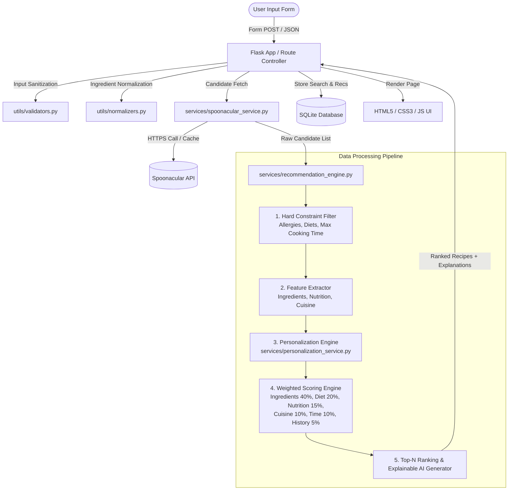

# Flavour Fusion - AI-Driven Personalised Recipe Recommendation Platform

> **Fixed Resume Description Alignment:**
> *"Developed an AI-driven recipe recommendation platform using Flask, Python, HTML, CSS, and JavaScript. Processed user inputs to generate personalized recommendations through backend data processing."*

---

## 1. Project Overview & Problem Statement

Modern food consumers and meal planners often struggle to find recipes tailored to their exact fridge contents, dietary requirements, and nutritional goals. Generic recipe apps return overwhelming search results without ranking recipes based on actual ingredient coverage or macro compliance.

**Flavour Fusion** solves this problem by providing an **AI-driven, explainable recommendation platform**. Rather than performing basic keyword matching or black-box predictions, Flavour Fusion implements a transparent, multi-criteria recommendation engine in Python that processes raw user inputs, extracts features from Spoonacular candidate recipes, enforces hard constraint filters, applies implicit history personalization, and ranks recipes using a weighted scoring formula.

---

## 2. Core Features

- 💡 **AI-Driven Local Recommendation Engine**: Multi-criteria weighted algorithm (`recommendation_engine.py`) calculating component scores for Ingredients (40%), Dietary match (20%), Nutrition fit (15%), Cuisine match (10%), Cooking time (10%), and Personalization history (5%).
- 🔍 **Ingredient Matching & Coverage**: Normalizes input strings, computes matched vs missing ingredients, and displays exact ingredient coverage percentages.
- 🛡️ **Hard Constraints vs. Soft Preferences**:
  - *Hard Constraints*: Allergy exclusions, strict dietary requirements (Vegan, Vegetarian, Gluten Free, Dairy Free, Keto), and max cooking time bounds.
  - *Soft Preferences*: Cuisine affinity, macronutrient fit (calories, protein, fat, carbs), and historical user interactions.
- 📊 **Explainable AI (XAI)**: Provides bullet-point explanations ("Why recommended") and interactive component score breakdowns for every card.
- 🔄 **Spoonacular API Integration with Offline Fallback**: Isolated API service (`services/spoonacular_service.py`) featuring response caching and fallback mock dataset execution when offline or API key is unconfigured.
- 👤 **Implicit Personalization & History**: Tracks past searches and recipe view interactions in SQLite to dynamically boost user-preferred cuisines and ingredients.
- 📈 **Pandas-Powered Analytics Dashboard**: Visualizes platform search queries, top ingredients, preferred cuisines, missing ingredients, and average recommendation scores.
- 🧪 **Comprehensive Automated Test Suite**: Full coverage using `pytest` for algorithm scoring, data processing, input validation, and database operations.

---

## 3. Technology Stack

- **Backend Framework**: Flask (Python 3.10+)
- **Data Processing & Analytics**: Python, Pandas, Regex
- **Database**: SQLite3 (Parameterized SQL)
- **External Recipe Source**: Spoonacular REST API
- **Frontend**: HTML5, Vanilla CSS3 (Dark mode glassmorphism), Vanilla JavaScript (ES6)
- **Testing Framework**: `pytest`

---

## 4. System Architecture & Data Processing Pipeline



---

## 5. Recommendation Algorithm & Mathematical Formula

Every candidate recipe receives an explainable composite recommendation score $S_{final} \in [0, 100]$:

$$S_{final} = (w_{ing} \cdot S_{ing}) + (w_{diet} \cdot S_{diet}) + (w_{nutr} \cdot S_{nutr}) + (w_{cuis} \cdot S_{cuis}) + (w_{time} \cdot S_{time}) + (w_{hist} \cdot S_{hist})$$

Where default configurable weights are:

- $w_{ing} = 0.40$ (Ingredient Coverage)
- $w_{diet} = 0.20$ (Dietary Restriction Fit)
- $w_{nutr} = 0.15$ (Nutritional Macro Fit)
- $w_{cuis} = 0.10$ (Cuisine Preference Match)
- $w_{time} = 0.10$ (Cooking Time Fit)
- $w_{hist} = 0.05$ (User Interaction History)

### Component Formula Breakdown:

1. **Ingredient Coverage Score ($S_{ing}$)**:
   $$S_{ing} = \frac{|\text{Matched Ingredients}|}{|\text{Required Recipe Ingredients}|} \times 100$$
2. **Dietary Score ($S_{diet}$)**: 100% if diet restriction is met or unspecified; 0% (and hard constraint filter) if violated.
3. **Nutrition Score ($S_{nutr}$)**: A combined linear penalty score measuring calorie overages and protein/fat target deviations.
4. **Cuisine Match Score ($S_{cuis}$)**: 100% for exact target match, 80% for unspecified ("Any"), 20% for mismatch.
5. **Cooking Time Score ($S_{time}$)**: 100% if $\text{readyInMinutes} \le \text{max\_time}$; linear decay penalty if over.
6. **User History Score ($S_{hist}$)**: Similarity metric derived from user's top interacted cuisines and ingredients stored in SQLite.

---

## 6. Database Schema (SQLite)

- **`users`**: User records (`id`, `created_at`).
- **`user_preferences`**: Persistent baseline user profile (`diet`, `cuisine`, `max_calories`, `min_protein`, etc.).
- **`searches`**: Search history log (`ingredients`, `diet`, `cuisine`, `allergies`, `created_at`).
- **`recommendations`**: Saved recommendation outputs with score breakdowns (`search_id`, `recipe_id`, `recommendation_score`, `ingredient_score`, `explanation`, etc.).
- **`recipe_interactions`**: User interaction log (`user_id`, `recipe_id`, `recipe_name`, `interaction_type`, `created_at`).

---

## 7. Installation & Setup Guide

### 1. Prerequisites
- Python 3.10+ installed on your machine.

### 2. Clone repository & set up virtual environment
```powershell
cd "c:\Users\Rajaharshini Arepati\OneDrive - CVR College of Engineering\Desktop\Flavour_fusion2"
python -m venv venv
.\venv\Scripts\Activate.ps1
```

### 3. Install dependencies
```powershell
pip install -r requirements.txt
```

### 4. Configure Environment Variables
Copy `.env.example` to `.env` and set your Spoonacular API key:
```ini
SPOONACULAR_API_KEY=2b8ecb1166574e9194dc03fc7a89a083
FLASK_SECRET_KEY=flavour_fusion_secret_key
DATABASE_PATH=flavour_fusion.db
```

### 5. Launch Application
```powershell
python app.py
```
Open your browser and navigate to: `http://127.0.0.1:5000`

---

## 8. Running Automated Tests

Run the test suite with pytest:
```powershell
python -m pytest tests/ -v
```

---

## 9. Interview Defensibility & Q&A Guide

### Basic Questions
- **What is Flavour Fusion?**  
  An AI-driven recipe recommendation platform that processes user available ingredients, dietary constraints, and macro goals to generate personalized, ranked recipe recommendations with explainable AI scores.
- **Why Flask?**  
  Flask is lightweight, modular, and ideal for building custom data processing pipelines and RESTful web applications without framework bloat.
- **How does the API key fallback work?**  
  If the Spoonacular API is offline or rate-limited, `SPOONACULAR_SERVICE` seamlessly falls back to a structured offline mock dataset, ensuring zero downtime.

### Technical Questions
- **Did you train a custom Machine Learning model?**  
  *"No, I did not train a custom neural network or ML model. I engineered an intelligent, explainable recommendation engine in Python that processes user inputs and Spoonacular recipe data, extracts feature vectors, enforces constraint filters, and ranks recipes using a weighted multi-criteria decision algorithm."*
- **How are ingredients matched and normalized?**  
  Raw input strings are cleaned via regular expressions, lowercased, stripped of punctuation, singularized, and evaluated for substring and set intersections against candidate recipe ingredients.
- **How does personalization work?**  
  When a user views recipes or submits queries, interaction logs are saved in SQLite. The personalization service calculates an implicit user profile (top cuisines, top ingredients) to apply a deterministic ranking boost when explicit preferences are unspecified.

### Data & Analytics (CEDA) Questions
- **Where is data processing happening?**  
  All data cleaning, normalization, feature extraction, scoring, and analytics aggregations occur locally on the Flask/Python backend.
- **How are analytics metrics computed?**  
  The `/analytics` endpoint reads search logs and recommendation tables from SQLite and uses `Pandas` series/dataframe operations (`value_counts`, `mean`, `dropna`) to compute platform insights.
